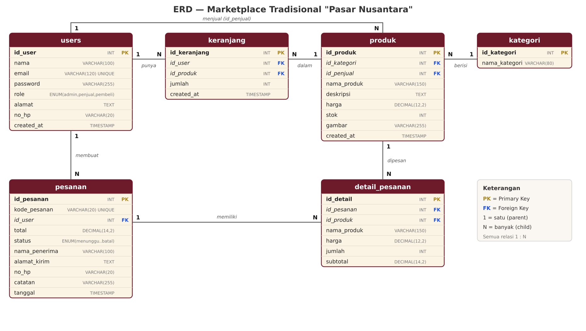
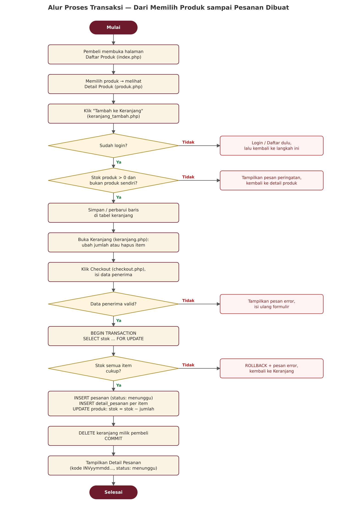
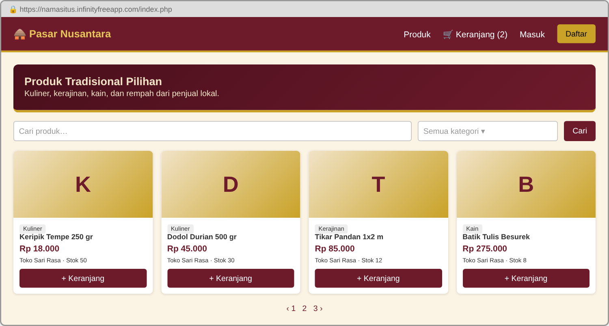
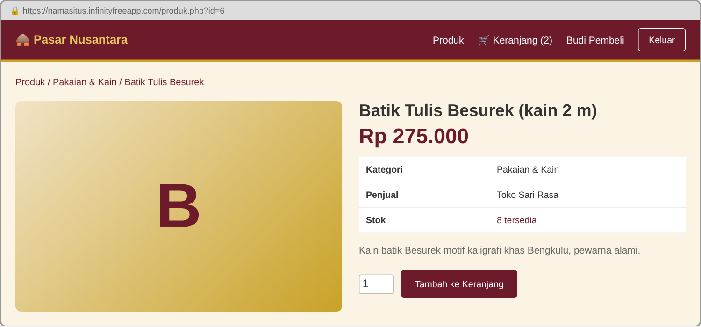
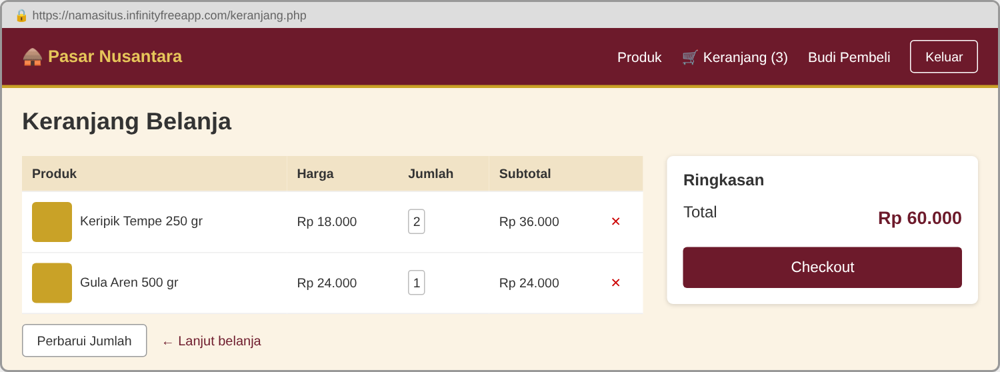

# 1. Pendahuluan

Pasar Nusantara adalah aplikasi marketplace sederhana yang mempertemukan **penjual** (menawarkan produk tradisional: kuliner, kerajinan, kain, rempah) dan **pembeli** (memilih produk, memasukkan ke keranjang, lalu membuat pesanan). Aplikasi dibangun dengan PHP Native, MySQLi (prepared statement), dan Bootstrap 5.

**Aktor dan hak akses**

| Aktor | Hak akses |
|---|---|
| Pengunjung | Melihat daftar dan detail produk, mendaftar, masuk |
| Pembeli | Semua hak pengunjung + keranjang, checkout, riwayat pesanan |
| Penjual | CRUD produk miliknya, melihat pesanan yang memuat produknya |
| Admin | CRUD semua produk, melihat semua pesanan, mengubah status pesanan |

# 2. Bagian A — Analisis dan Perancangan Sistem

## a. Identifikasi Entitas

Teridentifikasi **6 entitas**:

| No | Entitas (tabel) | Deskripsi |
|---|---|---|
| 1 | `users` | Pengguna sistem (admin, penjual, pembeli) beserta kredensial dan alamat |
| 2 | `kategori` | Pengelompokan produk (Kuliner, Kerajinan, Kain, Rempah) |
| 3 | `produk` | Barang yang dijual: nama, harga, stok, gambar, pemilik (penjual) |
| 4 | `keranjang` | Item sementara yang dipilih pembeli sebelum checkout |
| 5 | `pesanan` | Header transaksi: kode, pembeli, total, status, data pengiriman |
| 6 | `detail_pesanan` | Rincian item per pesanan (snapshot nama dan harga saat transaksi) |

## b. Rancangan Database Relasional

Basis data memakai InnoDB (mendukung transaksi dan foreign key), charset `utf8mb4`. Rancangan memenuhi bentuk normal ketiga (3NF). Satu denormalisasi disengaja: `detail_pesanan.nama_produk` dan `harga` menyimpan *snapshot* agar riwayat pesanan tidak berubah ketika produk diedit atau dihapus.

### Kamus data

**users**

| Atribut | Tipe | Kunci | Keterangan |
|---|---|---|---|
| id_user | INT UNSIGNED, AUTO_INCREMENT | PK | |
| nama | VARCHAR(100) | | NOT NULL |
| email | VARCHAR(120) | UNIQUE | NOT NULL |
| password | VARCHAR(255) | | Hash bcrypt (`password_hash`) |
| role | ENUM('admin','penjual','pembeli') | | Default `pembeli` |
| alamat | TEXT | | Opsional |
| no_hp | VARCHAR(20) | | Opsional |
| created_at | TIMESTAMP | | Default waktu sekarang |

**kategori**

| Atribut | Tipe | Kunci | Keterangan |
|---|---|---|---|
| id_kategori | INT UNSIGNED, AUTO_INCREMENT | PK | |
| nama_kategori | VARCHAR(80) | UNIQUE | NOT NULL |

**produk**

| Atribut | Tipe | Kunci | Keterangan |
|---|---|---|---|
| id_produk | INT UNSIGNED, AUTO_INCREMENT | PK | |
| id_kategori | INT UNSIGNED | FK → kategori | NULL bila kategori dihapus |
| id_penjual | INT UNSIGNED | FK → users | Pemilik produk |
| nama_produk | VARCHAR(150) | | NOT NULL |
| deskripsi | TEXT | | |
| harga | DECIMAL(12,2) | | NOT NULL |
| stok | INT UNSIGNED | | Default 0 |
| gambar | VARCHAR(255) | | Nama file di folder `uploads/` |
| created_at | TIMESTAMP | | |

**keranjang**

| Atribut | Tipe | Kunci | Keterangan |
|---|---|---|---|
| id_keranjang | INT UNSIGNED, AUTO_INCREMENT | PK | |
| id_user | INT UNSIGNED | FK → users | |
| id_produk | INT UNSIGNED | FK → produk | |
| jumlah | INT UNSIGNED | | Default 1 |
| created_at | TIMESTAMP | | |

Ada UNIQUE (`id_user`, `id_produk`): satu produk hanya satu baris per pembeli, penambahan berikutnya menaikkan `jumlah`.

**pesanan**

| Atribut | Tipe | Kunci | Keterangan |
|---|---|---|---|
| id_pesanan | INT UNSIGNED, AUTO_INCREMENT | PK | |
| kode_pesanan | VARCHAR(20) | UNIQUE | Format `INVyymmdd` + 6 hex acak |
| id_user | INT UNSIGNED | FK → users | Pembeli |
| total | DECIMAL(14,2) | | Dihitung server dari harga di database |
| status | ENUM('menunggu','dibayar','dikirim','selesai','batal') | | Default `menunggu` |
| nama_penerima | VARCHAR(100) | | |
| alamat_kirim | TEXT | | |
| no_hp | VARCHAR(20) | | |
| catatan | VARCHAR(255) | | Opsional |
| tanggal | TIMESTAMP | | |

**detail_pesanan**

| Atribut | Tipe | Kunci | Keterangan |
|---|---|---|---|
| id_detail | INT UNSIGNED, AUTO_INCREMENT | PK | |
| id_pesanan | INT UNSIGNED | FK → pesanan | |
| id_produk | INT UNSIGNED | FK → produk | NULL bila produk dihapus |
| nama_produk | VARCHAR(150) | | Snapshot |
| harga | DECIMAL(12,2) | | Snapshot |
| jumlah | INT UNSIGNED | | |
| subtotal | DECIMAL(14,2) | | harga × jumlah |

### Hubungan antar-tabel

| Relasi | Kardinalitas | Foreign key | Aksi hapus |
|---|---|---|---|
| kategori — produk | 1 : N | produk.id_kategori | SET NULL |
| users (penjual) — produk | 1 : N | produk.id_penjual | CASCADE |
| users — keranjang | 1 : N | keranjang.id_user | CASCADE |
| produk — keranjang | 1 : N | keranjang.id_produk | CASCADE |
| users — pesanan | 1 : N | pesanan.id_user | RESTRICT |
| pesanan — detail_pesanan | 1 : N | detail_pesanan.id_pesanan | CASCADE |
| produk — detail_pesanan | 1 : N | detail_pesanan.id_produk | SET NULL |

Secara konseptual `users` dan `produk` berhubungan M : N lewat `keranjang`, dan `pesanan` dan `produk` M : N lewat `detail_pesanan` (tabel asosiasi). Skrip lengkap ada di `database.sql`.

## c. Entity Relationship Diagram (ERD)



## d. Alur Proses Transaksi



**Penjelasan alur**

1. Pembeli membuka daftar produk, dapat mencari dan memfilter kategori, lalu membuka detail produk.
2. Klik *Tambah ke Keranjang*. Sistem memeriksa login, stok, dan memastikan produk bukan milik pembeli sendiri. Jumlah dibatasi sesuai stok.
3. Pembeli membuka keranjang untuk mengubah jumlah atau menghapus item, lalu klik *Checkout*.
4. Pembeli mengisi data penerima. Server memvalidasi masukan.
5. Server memulai **transaksi database**: setiap produk dikunci dengan `SELECT … FOR UPDATE`, stok diperiksa ulang, total dihitung dari harga di database (bukan dari input pengguna).
6. Jika semua stok cukup: `INSERT pesanan`, `INSERT detail_pesanan` per item, `UPDATE produk` (kurangi stok), `DELETE keranjang`, lalu `COMMIT`. Jika ada kegagalan: `ROLLBACK` sehingga tidak ada data setengah jadi.
7. Pembeli diarahkan ke halaman detail pesanan dengan status *menunggu*.

## e. Rancangan Antarmuka (Mockup UI)

**Daftar produk**



Elemen: navbar (brand, Produk, Keranjang dengan badge jumlah, Masuk/Daftar), banner, formulir pencarian dan filter kategori, grid kartu produk (gambar, kategori, nama, harga, penjual, stok, tombol *+ Keranjang*), dan paginasi.

**Detail produk**



Elemen: breadcrumb, gambar besar, nama, harga, tabel kategori/penjual/stok, deskripsi, input jumlah dan tombol *Tambah ke Keranjang*.

**Keranjang belanja**



Elemen: tabel item (gambar mini, harga, input jumlah, subtotal, tombol hapus), tombol *Perbarui Jumlah*, kartu ringkasan total, dan tombol *Checkout*.

Berkas sumber mockup: `docs/mockup.html`.

# 3. Bagian B — Implementasi Aplikasi

## Struktur proyek

```
marketplace-tradisional/
├── index.php              Daftar produk (cari, filter, paginasi)
├── produk.php             Detail produk
├── keranjang_tambah.php   Tambah ke keranjang
├── keranjang.php          Lihat / ubah / hapus item keranjang
├── checkout.php           Buat pesanan (transaksi database)
├── pesanan.php            Riwayat pesanan pembeli
├── pesanan_detail.php     Rincian satu pesanan
├── login.php, register.php, logout.php
├── admin/
│   ├── produk.php         Daftar produk (kelola)
│   ├── produk_form.php    Tambah & edit produk (+ upload gambar)
│   ├── produk_hapus.php   Hapus produk
│   └── pesanan.php        Pesanan masuk, ubah status (admin)
├── includes/              init.php (koneksi + helper), header.php, footer.php
├── assets/style.css
├── uploads/               Gambar produk (isi tidak di-commit)
├── database.sql           Skema + data contoh
├── config.sample.php      Contoh konfigurasi (config.php di-ignore Git)
└── docs/                  Dokumen, ERD, mockup
```

## Pemenuhan fitur wajib

| Fitur | Berkas |
|---|---|
| Menampilkan daftar produk | `index.php` |
| Menampilkan detail produk | `produk.php` |
| CRUD produk | `admin/produk.php` (Read), `admin/produk_form.php` (Create, Update), `admin/produk_hapus.php` (Delete) |
| Tambah produk ke keranjang | `keranjang_tambah.php`, `keranjang.php` |
| Membuat dan menyimpan transaksi pesanan | `checkout.php` → tabel `pesanan` dan `detail_pesanan` |

## Keamanan yang diterapkan

- **SQL injection**: seluruh query memakai prepared statement MySQLi.
- **XSS**: semua keluaran HTML melewati `htmlspecialchars` (fungsi `e()`).
- **CSRF**: setiap form POST membawa token sesi yang diverifikasi.
- **Password**: disimpan dengan `password_hash` (bcrypt), diverifikasi `password_verify`; `session_regenerate_id` saat login.
- **Otorisasi**: pengecekan peran dan kepemilikan produk/pesanan di sisi server.
- **Integritas harga/stok**: total dihitung ulang di server; stok dikunci dalam transaksi.
- **Upload**: validasi ukuran (maks. 2 MB), tipe lewat `getimagesize`, nama file acak, eksekusi PHP di `uploads/` ditolak lewat `.htaccess`.
- **Kredensial**: `config.php` masuk `.gitignore`; repository hanya berisi `config.sample.php`.

## Menjalankan secara lokal (XAMPP/Laragon)

1. Salin folder proyek ke `htdocs`.
2. Buat database `db_marketplace` di phpMyAdmin, lalu impor `database.sql`.
3. Salin `config.sample.php` menjadi `config.php`. Saat diakses lewat `localhost`, file ini otomatis memakai `DB_HOST=localhost`, `DB_USER=root`, `DB_PASS` kosong, `DB_NAME=db_marketplace`; `BASE_URL` terdeteksi otomatis dari nama folder.
4. Buka `http://localhost/marketplace-tradisional/`.

**Akun demo** (hanya untuk keperluan tugas): `admin@pasar.test / admin123`, `penjual@pasar.test / penjual123`, `pembeli@pasar.test / pembeli123`.

# 4. Bagian C — Deployment dan Publikasi

## h. Deployment ke InfinityFree

1. Daftar di <https://infinityfree.com> dan buat akun hosting (pilih subdomain gratis).
2. Di Client Area, buka **Control Panel** akun hosting, menu **MySQL Databases**, lalu buat database (misal `marketplace`). Catat **MySQL Hostname** (berbentuk `sqlXXX.infinityfree.com`, *bukan* `localhost`), username `if0_…`, nama database lengkap `if0_…_marketplace`, dan password database dari Client Area. Hostname bisa butuh beberapa saat sebelum muncul.
3. Buka **phpMyAdmin** dari daftar database, pilih database tersebut, tab **Import**, unggah `database.sql`. (Jangan menjalankan `CREATE DATABASE`; file ini tidak memuatnya.)
4. Di komputer, salin `config.sample.php` menjadi `config.php`, lalu isi bagian `INFINITYFREE` dengan data langkah 2 (bagian XAMPP dibiarkan). Di hosting, file otomatis memakai bagian InfinityFree karena domainnya bukan localhost, dan `BASE_URL` otomatis kosong bila diunggah ke root `htdocs`.
5. Unggah seluruh isi proyek (termasuk `config.php`, **tanpa** folder `.git`) ke folder **`htdocs`** lewat FTP (FileZilla; kredensial FTP ada di Client Area) atau Online File Manager. Hapus `index2.html` bawaan jika ada.
6. Buka URL subdomain Anda dan lakukan pengujian (bagian 5).

## i. Unggah ke GitHub

```bash
cd marketplace-tradisional
git init
git add .
git status          # pastikan config.php TIDAK ada dalam daftar
git commit -m "Marketplace tradisional: PHP native + MySQLi + Bootstrap"
git branch -M main
git remote add origin https://github.com/USERNAME/marketplace-tradisional.git
git push -u origin main
```

Buat dulu repository kosong di <https://github.com/new>. Karena `.gitignore` mengecualikan `config.php`, password database tidak ikut terunggah. Jika pernah tak sengaja ter-commit, ganti password database di InfinityFree.

# 5. Laporan dan Bukti Pengujian

## j. Informasi yang dicantumkan dalam laporan

| Item | Isi |
|---|---|
| URL demo (InfinityFree) | *(isi setelah deploy)* |
| URL repository GitHub | *(isi setelah push)* |
| Screenshot aplikasi berjalan | Daftar produk, detail produk, keranjang, checkout, detail pesanan, kelola produk |
| Screenshot struktur database | phpMyAdmin → tab **Struktur** (6 tabel) dan **Designer** (relasi) |
| Screenshot hasil uji transaksi | Hasil query di bawah setelah checkout |

## Skenario pengujian

| ID | Skenario | Hasil yang diharapkan | Hasil (isi) |
|---|---|---|---|
| TC-01 | Buka beranda tanpa login | Daftar produk tampil, pencarian dan filter bekerja | |
| TC-02 | Buka detail produk | Nama, harga, stok, deskripsi tampil | |
| TC-03 | Tambah ke keranjang tanpa login | Diarahkan ke halaman login | |
| TC-04 | Login pembeli, tambah 2 produk | Badge keranjang bertambah, item tampil di keranjang | |
| TC-05 | Ubah jumlah melebihi stok | Jumlah dibatasi sesuai stok | |
| TC-06 | Checkout dengan data kosong | Pesan validasi, pesanan tidak dibuat | |
| TC-07 | Checkout dengan data valid | Pesanan dibuat, kode `INV…`, stok berkurang, keranjang kosong | |
| TC-08 | Login penjual, tambah/edit/hapus produk | Perubahan tersimpan dan tampil di beranda | |
| TC-09 | Pembeli membuka `/admin/produk.php` | Ditolak (403) | |
| TC-10 | Admin ubah status pesanan | Status berubah, tampil di riwayat pembeli | |

## Query bukti transaksi (jalankan di phpMyAdmin → SQL)

```sql
-- Pesanan terbaru
SELECT id_pesanan, kode_pesanan, id_user, total, status, tanggal
FROM pesanan ORDER BY id_pesanan DESC LIMIT 5;

-- Rincian item pesanan terbaru
SELECT d.* FROM detail_pesanan d
JOIN pesanan p ON p.id_pesanan = d.id_pesanan
WHERE p.id_pesanan = (SELECT MAX(id_pesanan) FROM pesanan);

-- Stok setelah transaksi (bandingkan dengan sebelum checkout)
SELECT id_produk, nama_produk, stok FROM produk ORDER BY id_produk;

-- Keranjang pembeli harus kosong setelah checkout
SELECT * FROM keranjang;
```

# 6. Penutup

Aplikasi memenuhi seluruh fitur wajib: daftar produk, detail produk, CRUD produk, keranjang, dan penyimpanan transaksi ke database dengan mekanisme transaksi (COMMIT/ROLLBACK) serta pengamanan dasar. Pengembangan lanjutan yang mungkin: integrasi pembayaran, ongkos kirim, ulasan produk, dan manajemen kategori.
